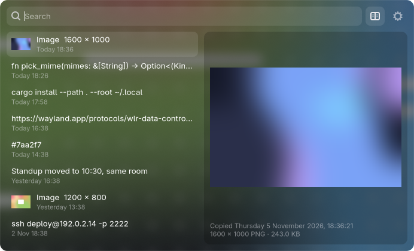
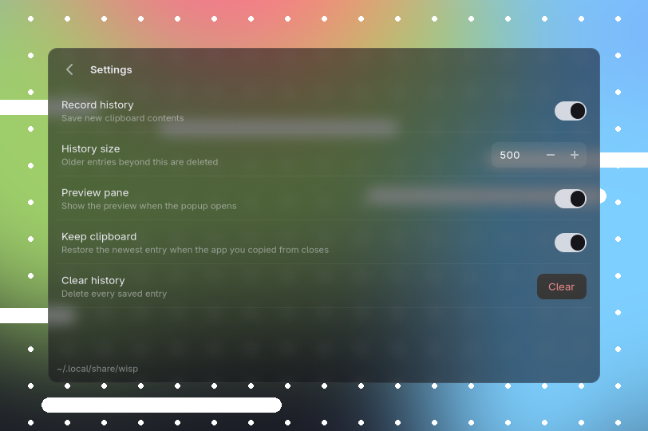

<div align="center">


# wisp

**A small, quiet clipboard history for Wayland.**

Text and images, the time you copied them, a preview pane, and a frosted popup
that stays out of your way, written in Rust.



</div>

## Features

- **Text and images.** Records plain text and PNG, JPEG and WebP images, with thumbnails in the list.
- **Copy times.** Every entry shows when it was copied, like *Today 14:32* or *Yesterday 09:10*, and the preview shows the full date and time.
- **Kept across reboots.** History is a local SQLite database. Copying something that's already in the history moves it to the top instead of adding a duplicate.
- **Preview pane.** Shows the full text or the image, with its size and dimensions. Toggle it with <kbd>Ctrl</kbd>+<kbd>P</kbd>.
- **Search.** Start typing to filter.
- **Transparent and blurred.** The popup is a translucent card. On compositors that support it, the background behind it is blurred.
- **Pause recording.** Turn history on or off from the settings view without stopping anything.
- **Keeps your clipboard alive.** When the app you copied from closes, wisp can hand the newest entry back, so paste still works.
- **Skips passwords.** Anything a password manager marks as secret (`x-kde-passwordManagerHint`) is never recorded.
- **Light.** The background daemon sleeps until something is copied. The popup only runs while it's open.

<div align="center">

</div>

## How it works

wisp is two small programs:

| | What it does | Cost |
| --- | --- | --- |
| `wispd` | Watches the clipboard over `wlr-data-control`, stores history, and serves entries you pick. No GTK. | ~6 MB RAM, 0% CPU when idle |
| `wisp` | The GTK4 popup, shown as a `wlr-layer-shell` overlay. Starts when you open it, exits when you close it. Running `wisp` again while it's open closes it, so one keybind toggles it. | ~100 ms to open, ~120 MB only while open |

They talk over a Unix socket at `$XDG_RUNTIME_DIR/wisp.sock`. History lives in
`~/.local/share/wisp/` and settings in `~/.config/wisp/config.toml`.

## Requirements

- **A Wayland compositor with `wlr-data-control` and `wlr-layer-shell`.** Developed and tested on Hyprland. Other compositors with both protocols should work but are untested.
- **GTK 4.20 or newer and `gtk4-layer-shell`.**
- **A recent stable Rust toolchain** to build (the code uses edition 2024).
- **Optional, for blur:** GTK 4.22 or newer and a compositor that supports `ext-background-effect-v1` (Hyprland 0.57 does). Without it, the card is translucent but not blurred.

On Arch Linux:

```sh
sudo pacman -S --needed gtk4 gtk4-layer-shell sqlite rust
```

## Install

```sh
git clone https://github.com/athenameow/wisp.git
cd wisp
cargo install --path . --root ~/.local   # installs wisp and wispd to ~/.local/bin
```

Start the daemon with your graphical session:

```sh
install -Dm644 contrib/wisp.service ~/.config/systemd/user/wisp.service
systemctl --user enable --now wisp
```

The unit is tied to `graphical-session.target`, which UWSM and most session managers provide.
If yours doesn't, start `wispd` from your compositor's autostart instead.

Optionally, add wisp to your app launcher with its icon:

```sh
install -Dm644 data/icons/io.athena.wisp.svg ~/.local/share/icons/hicolor/scalable/apps/io.athena.wisp.svg
install -Dm644 data/io.athena.wisp.desktop ~/.local/share/applications/io.athena.wisp.desktop
gtk-update-icon-cache -f -t ~/.local/share/icons/hicolor
```

### Keybind

**Hyprland, Lua config:**

```lua
hl.bind("SUPER + V", hl.dsp.exec_cmd(os.getenv("HOME") .. "/.local/bin/wisp"))

-- Optional: show the popup instantly instead of fading it in.
hl.layer_rule({ name = "wisp", match = { namespace = "^wisp$" }, no_anim = true })
```

**Hyprland, `hyprland.conf`:**

```ini
bind = SUPER, V, exec, ~/.local/bin/wisp
```

**Sway:**

```
bindsym $mod+v exec ~/.local/bin/wisp
```

You don't need a blur rule. wisp asks the compositor to blur the card itself,
and the blur strength follows your compositor's global blur settings.

## Usage

| Key | Action |
| --- | --- |
| Type | Search |
| <kbd>↑</kbd> <kbd>↓</kbd> <kbd>PgUp</kbd> <kbd>PgDn</kbd> | Move through the list |
| <kbd>Enter</kbd> or click | Copy the entry and close |
| Hover | Select the entry and preview it |
| <kbd>Delete</kbd> | Remove the entry |
| <kbd>Ctrl</kbd>+<kbd>P</kbd> | Toggle the preview pane |
| <kbd>Ctrl</kbd>+<kbd>,</kbd> | Settings |
| <kbd>Esc</kbd> or click outside | Close |

## Configuration

Everything is available in the settings view (<kbd>Ctrl</kbd>+<kbd>,</kbd>), which writes
`~/.config/wisp/config.toml`:

```toml
history_enabled = true   # record new clipboard contents
max_entries = 500        # older entries are deleted
show_preview = true      # open with the preview pane visible
keep_clipboard = true    # restore the newest entry when the source app closes
max_item_mb = 64         # larger contents are not recorded
```

### Styling

The popup is styled with GTK CSS. Put overrides in `~/.config/wisp/style.css`. They load after the
built-in style, so you only need the rules you change. For example, a more opaque card:

```css
.card {
  background-color: rgba(16, 16, 20, 0.85);
}
```

See [`src/bin/wisp/style.css`](src/bin/wisp/style.css) for every selector.

## Privacy

Everything stays on your machine. wisp makes no network connections.
History is stored unencrypted in `~/.local/share/wisp/`, which wisp keeps readable by your user
only (mode `700`). Clear it from the settings view at any time.

Entries marked secret by password managers are never recorded. Anything else you copy is, so turn
off *Record history* in settings before copying something sensitive from an app that doesn't mark it.

## Uninstall

```sh
systemctl --user disable --now wisp
rm ~/.config/systemd/user/wisp.service
cargo uninstall wisp --root ~/.local
rm -f ~/.local/share/applications/io.athena.wisp.desktop ~/.local/share/icons/hicolor/scalable/apps/io.athena.wisp.svg
rm -r ~/.local/share/wisp ~/.config/wisp   # history and settings
```

## License

[MIT](LICENSE)
